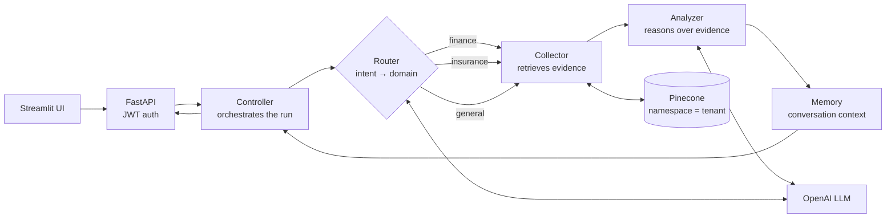
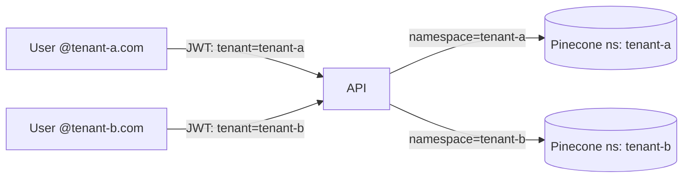

# Multi-Tenant Agentic AI — Architecture Showcase

An agentic RAG system that routes questions to domain-specific handling (finance, insurance, general), gathers evidence, analyzes it and remembers context, while keeping each tenant's data strictly isolated.

> **About this repository:** the implementation is private. This repository documents the agent architecture, tenant-isolation model and design decisions. Implementation walkthroughs are available on request.

---

## The problem

Moving from a single RAG chatbot to an enterprise agent platform raises three questions:

| Question | Risk if ignored | Answer in this architecture |
|---|---|---|
| **Which knowledge should answer this?** | One generic pipeline gives shallow answers across very different domains | A router classifies intent and selects a domain path |
| **How do we keep the agent controllable?** | Free-form agents loop, over-call tools and are hard to debug | Fixed stages with clear responsibilities: controller → router → collector → analyzer → memory |
| **How do we keep tenants apart?** | One organization's documents leak into another's answers | Tenant identity from the JWT selects an isolated vector namespace on every call |

## Architecture at a glance

More detail: [docs/architecture.md](docs/architecture.md)

## Agent stages

| Stage | Responsibility | Why it is separate |
|---|---|---|
| **Controller** | Owns the run: calls each stage, enforces limits, assembles the response | One place to apply timeouts, step limits and error handling |
| **Router** | Classifies the request into finance, insurance or general | Domain-specific prompts and retrieval improve answer quality |
| **Collector** | Retrieves evidence from the tenant's namespace | Retrieval can be tuned per domain without touching reasoning |
| **Analyzer** | Reasons over the collected evidence and drafts the answer | Keeps the LLM grounded in what was actually retrieved |
| **Memory** | Stores and recalls conversation context | Follow-up questions work without re-sending history |

## Multi-tenant isolation

- Tenant identity is derived from the authenticated user's login domain and carried in the JWT.
- The namespace is set server-side from the token on every retrieval and write. It is never taken from user input.

See [ADR-0002](docs/adr/0002-tenant-isolation-namespaces.md).

## Architecture Decision Records

| ADR | Decision |
|---|---|
| [0001](docs/adr/0001-staged-agent-pipeline.md) | A staged agent pipeline instead of a free-form autonomous agent |
| [0002](docs/adr/0002-tenant-isolation-namespaces.md) | Tenant isolation through JWT-scoped vector namespaces |
| [0003](docs/adr/0003-domain-routing.md) | Route by domain before retrieval |

## Technology

Python · FastAPI · Streamlit · OpenAI · Pinecone · JWT · Azure deployment

## Author

**Suryamitra Yellayi** — AI Solution Architect · [LinkedIn](https://www.linkedin.com/in/suryamitra-yellayi/)
