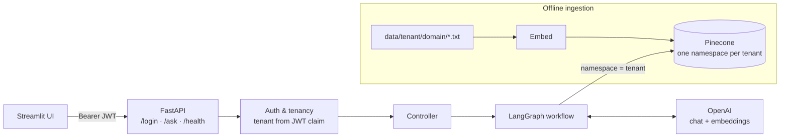
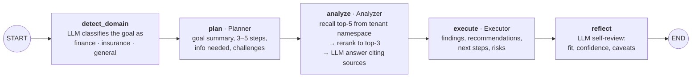
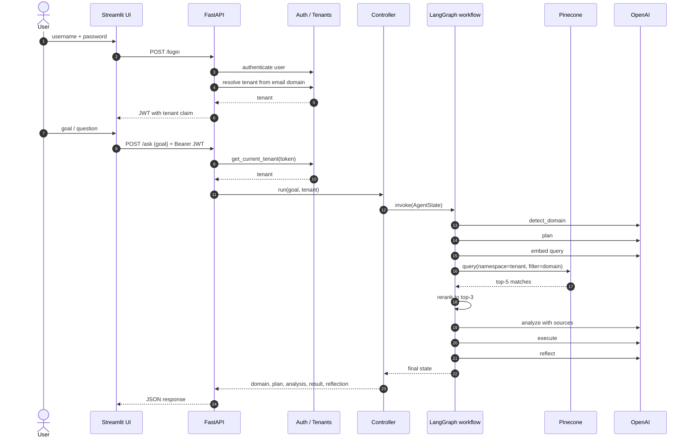
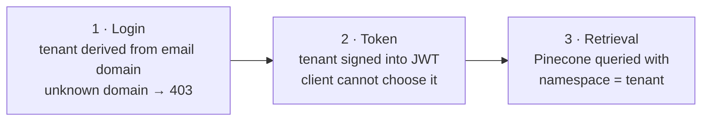

# Multi-Tenant Agentic RAG Assistant — Architecture Showcase

A multi-tenant, agentic RAG assistant for finance and insurance questions. A FastAPI backend authenticates users with JWT, maps each user to a tenant by email domain, and runs every question through a **LangGraph** pipeline of agents:

**detect domain → plan → RAG analysis → execute → reflect**

Retrieval is served from Pinecone with **one namespace per tenant**, so tenants never see each other's documents.

> **About this repository:** the implementation is private. This repository documents the architecture, tenant-isolation model and design decisions. Implementation walkthroughs are available on request.

---

## The problem

Moving from a single RAG chatbot to a multi-tenant agent platform raises three questions:

| Question | Risk if ignored | Answer in this architecture |
|---|---|---|
| **How do we keep tenants apart?** | One organization's documents leak into another's answers | Tenant is derived at login, signed into the JWT and enforced on every retrieval |
| **How do we keep the agent controllable?** | Free-form agents loop, over-call tools and are hard to debug | A fixed LangGraph pipeline with typed shared state and clear node responsibilities |
| **How do we get more than a one-line answer?** | Plain RAG returns facts but no plan, recommendation or confidence | Separate planning, execution and reflection nodes around the RAG step |

## Architecture

### System overview

Structured logging with request, tenant and goal context runs across the API and the workflow.

### Agent pipeline

Each node reads and extends a shared `AgentState`. Every node calls the LLM, and only `analyze` touches the vector store.

`AgentState` fields: `goal`, `tenant`, `domain`, `plan`, `analysis`, `execution_result`, `messages[]`.

### Request lifecycle

### Tenant isolation

Isolation is enforced at three points:

1. **Login:** the tenant comes from the user's email domain; unknown domains are rejected with 403.
2. **Token:** the tenant is a signed JWT claim. The `/ask` endpoint reads it only through a server-side dependency, never from the request body.
3. **Retrieval:** every Pinecone query uses `namespace=tenant`, and ingestion writes each tenant's documents into its own namespace.

## Components

| Layer | Responsibility |
|---|---|
| UI (Streamlit) | Login, hold the JWT, submit goals, render plan, analysis, result and reflection |
| API (FastAPI) | `/login`, `/ask`, `/health`; request-ID middleware; CORS |
| Auth | JWT create/decode, current-tenant dependency |
| Tenancy | Email domain → tenant resolution |
| Orchestration | LangGraph `StateGraph` driving the agent nodes |
| Agents | Planner, Analyzer, Executor, plus domain detection and reflection nodes |
| Retrieval | Pinecone recall per tenant namespace, cosine reranking |
| Config | Lazy-initialized OpenAI, Pinecone and embedding clients behind an `LLMAdapter` |
| Observability | Structured logs with request, tenant and goal context |
| Ingestion | Embeds per-tenant, per-domain documents into Pinecone |

## Architecture Decision Records

| ADR | Decision |
|---|---|
| [0001](docs/adr/0001-staged-agent-pipeline.md) | A fixed LangGraph pipeline instead of a free-form autonomous agent |
| [0002](docs/adr/0002-tenant-isolation-namespaces.md) | Tenant isolation through JWT-scoped vector namespaces |
| [0003](docs/adr/0003-domain-routing.md) | Detect the domain first and use it as a retrieval filter |
| [0004](docs/adr/0004-reflection-node.md) | End every run with a reflection node |

More detail: [docs/architecture.md](docs/architecture.md)

## Current scope and roadmap

This is a working reference implementation, deliberately scoped:

| Area | Today | Next |
|---|---|---|
| Authentication | Demo user store | Enterprise identity provider (OIDC / Entra ID) |
| Reranking | Cosine similarity over embeddings | Cross-encoder reranker |
| Quality | Manual validation | Automated evaluation per domain route |
| Flow | Linear graph | Conditional edges (e.g. re-plan on low confidence from `reflect`) |
| Tracing | Structured logs | LangSmith tracing and audit records |

## Technology

Python · FastAPI · LangGraph · OpenAI (`gpt-4o-mini`, `text-embedding-3-small`) · Pinecone · Streamlit · JWT

## Author

**Suryamitra Yellayi** — AI Solution Architect · [LinkedIn](https://www.linkedin.com/in/suryamitra-yellayi/)
