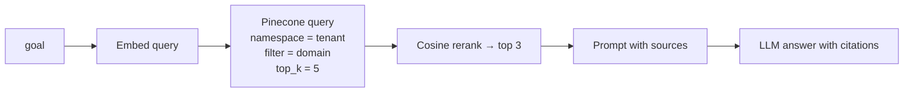
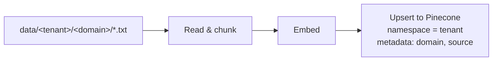

# Architecture

## 1. Shared state

LangGraph passes one `AgentState` object through every node. Each node adds its output; none overwrite earlier fields.

| Field | Set by | Used by |
|---|---|---|
| `goal` | API | All nodes |
| `tenant` | API (from JWT) | `analyze` (namespace) |
| `domain` | `detect_domain` | `analyze` (metadata filter) |
| `plan` | `plan` | `analyze`, `execute` |
| `analysis` | `analyze` | `execute`, `reflect` |
| `execution_result` | `execute` | `reflect` |
| `messages[]` | All nodes | Logging and debugging |

## 2. Node responsibilities

| Node | Input | Output | External calls |
|---|---|---|---|
| `detect_domain` | goal | finance / insurance / general | LLM |
| `plan` | goal, domain | summary, 3–5 steps, info needed, challenges | LLM |
| `analyze` | goal, plan, tenant, domain | answer citing sources | Embeddings, Pinecone, LLM |
| `execute` | plan, analysis | findings, recommendations, next steps, risks | LLM |
| `reflect` | all prior fields | fit, confidence, caveats | LLM |

## 3. Retrieval inside `analyze`

Two-stage retrieval: a wider recall (top 5) followed by a tighter rerank (top 3) keeps the prompt small while reducing the chance of missing the best chunk.

## 4. Ingestion

The folder structure itself encodes tenant and domain, so isolation and filtering are set at write time.

## 5. Cost and latency profile

Every request makes about five LLM calls plus one embedding call and one vector query. That is the tradeoff for structured, reviewable output. Options to reduce it:

- Skip `plan` or `execute` for simple factual questions (conditional edges)
- Use a smaller model for `detect_domain` and `reflect`
- Cache answers for repeated goals per tenant (as in the Secure Hybrid RAG Platform)
