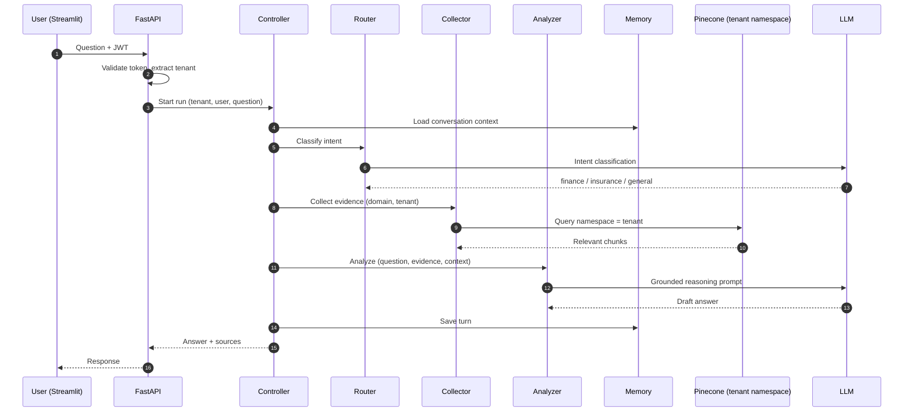
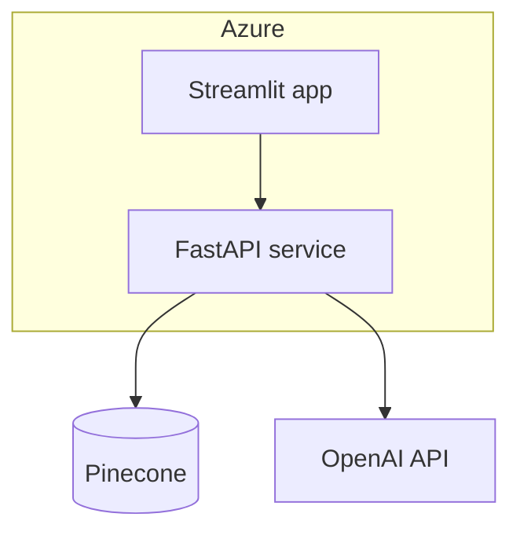

# Architecture

## 1. Request flow

## 2. Control and safety limits

| Limit | Purpose |
|---|---|
| Maximum steps per run | Prevents loops |
| Timeouts per stage | Keeps latency predictable |
| Server-side tenant scoping | Prevents cross-tenant retrieval |
| Grounded analysis prompt | Answers come from collected evidence |
| Structured stage outputs | Each stage's output can be logged and inspected |

## 3. Deployment view

## 4. Evolution path

| Next step | Benefit |
|---|---|
| Move orchestration to a graph framework (for example LangGraph) | Explicit state, retries and branching |
| Add tool calling to enterprise APIs | Agents act, not only answer |
| Add evaluation per domain route | Measure quality where it differs |
| Add tracing and audit logging (as in the Secure Hybrid RAG Platform) | Explainability in regulated settings |
